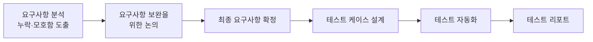
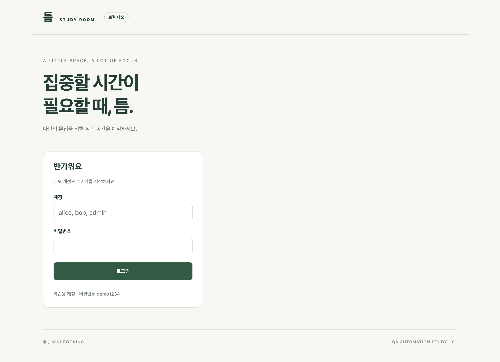
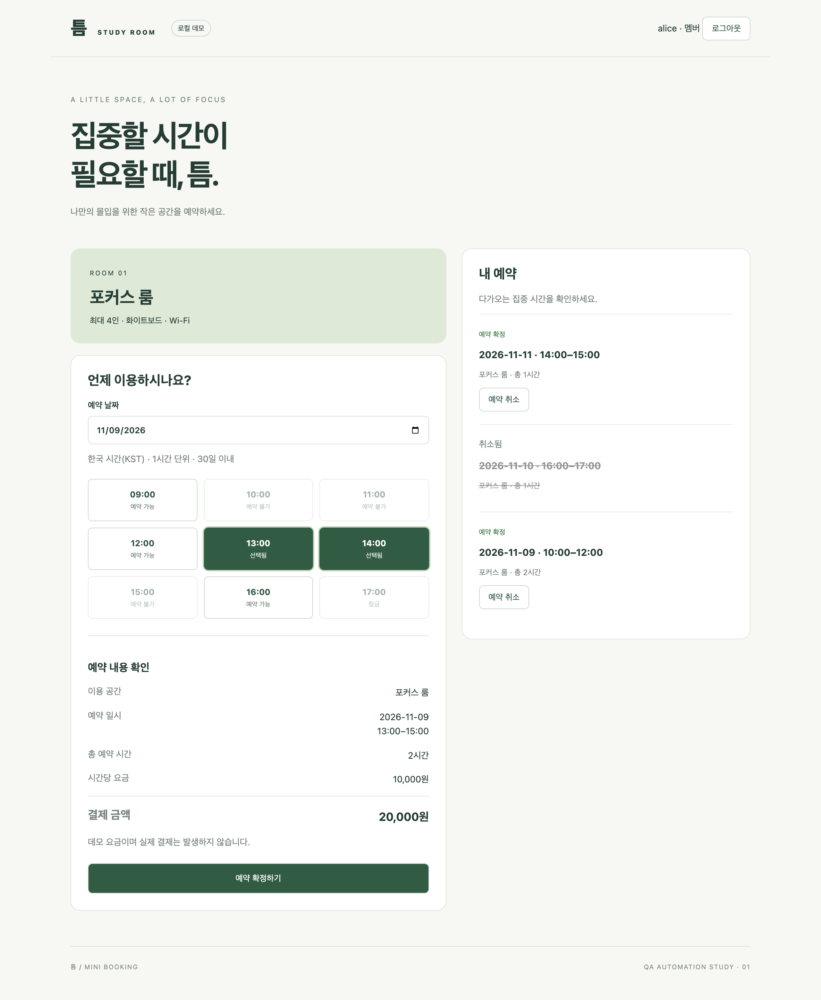

# 틈 · Mini Booking QA

[](https://github.com/iwannayoon/mini-booking-qa/actions/workflows/tests.yml)

**요구사항 분석 및 리뷰 → 테스트 케이스 설계 → 테스트 자동화 및 수행**의 전 과정을 하나의 서비스로 보여 주는 QA 포트폴리오입니다.

대상은 로컬에서 실행되는 작은 스터디룸 예약 서비스입니다. 기능을 많이 만드는 것이 아니라, **주어진 서비스를 무엇을 근거로, 어떤 기준으로, 어떻게 반복 가능하게 검증하는지**를 보여 주는 것이 목적입니다.
## 진행 과정 및 단계 별 산출물



| 단계         | 설명                                                                                                        | 산출물                                                                                                                                |
| ---------- | --------------------------------------------------------------------------------------------------------- | ---------------------------------------------------------------------------------------------------------------------------------- |
| 요구사항 분석    | 명세의 누락·모호함을 도출하고 보완합니다.                                                                                   | [요구사항 명세 초안](docs/requirements.md)<br>[요구사항 분석](docs/login-requirements-analysis.md)<br>[보완 후 요구사항 명세](docs/requirements-final.md) |
| 테스트 케이스 설계 | - 테스트 시나리오 및 케이스를 설계합니다.<br>- 어떤 조건을, 어느 레이어에서, 어떤 우선순위로 검증할 것인지 결정합니다.<br>- 테스트 절차에 대한 기대결과를 기록 및 관리합니다. | 테스트 케이스<br>- [로그인](docs/login-test-cases.md)<br>- [예약](docs/booking-test-cases.md)                                                 |
| 테스트 자동화    | - 복잡하고 다양한 테스트 절차를 어떻게 안정적으로 자동화합니다.<br>- 케이스 ID를 각 테스트 제목으로 연결하여 관리합니다.                                  | Playwright API·E2E 테스트, CI<br>- [테스트 폴더](tests/)                                                                                   |
| 결과 보고      | 무엇이 검증되었고, 그 근거는 무엇인지 정리합니다.                                                                              | 테스트 리포트<br>- [로그인](docs/login-test-report.md)<br>- [예약](docs/booking-test-report.md)                                               |

## 결과 요약

| 항목 | 수치 |
|---|---|
| 요구사항 | 27개 (기능 R-01~23, 저장·환경 N-01~04) |
| 테스트 케이스 | 59개 (로그인 34, 예약 25), 모두 자동화 테스트와 연결 |
| 자동화 테스트 | 169개 (API 83, E2E 86) |
| 실행 결과 | 전체 통과, 실패·불안정(flaky) 0, 전체 실행 약 26초 |

N-03(실행·테스트 환경)은 별도 케이스 없이 Playwright 설정과 CI로 충족합니다.

## 단계 별 상세 설명

### **요구사항 분석**
QA 활동은 요구사항을 전달받는 시점부터 시작된다고 생각합니다. 명시된 기능뿐 아니라 모호한 표현, 생략된 예외 상황, 서로 다르게 이해할 수 있는 암묵지를 찾아 이슈레이징하여 구체화해왔습니다. 이를 통해 구현과 테스트 단계에서 드러날 이슈를 초기에 인지하고, 검증 기준을 명확히 하고자 했습니다.

로그인 기능에서는 응답이 없을 때 얼마나 기다릴지, 시간 초과 후 도착한 응답을 어떻게 처리할지, 예약 기능에서는 예약 중복 발생 등에 대해 정의가 되지 않은 것을 인지했습니다.

### **테스트 시나리오 및 케이스 설계**
- 요구사항 별 테스트 시나리오를 도출하고, 이를 테스트 케이스로 상세화하여 커버리지를 보장합니다.
- 우선순위는 아래와 같은 기준으로 정의하였습니다.
	- **`P1`** 실패 시, 보안·데이터 무결성이 훼손되거나, 핵심 사용자 흐름을 완료할 수 없음
    - **`P2`** 실패 시, 핵심 사용자 흐름은 완료할 수 있으나, 일부 기능이 제한되거나 잘못된 안내·상태 표시로 사용자 혼동 또는 추가 조작을 유발하는 있음
    - **`P3`** 기능 수행과 결과 이해에 영향이 적은 경미한 UI·문구·사용성 관련 케이스

### **테스트 자동화
- 반복 검증에 드는 시간을 줄이고, 사람이 더 집중해야 하는 영역에 리소스를 확보하기 위해 테스트 자동화를 활용했습니다. 요구사항의 모호함을 발견하고, 사용자 관점에서 새로운 위험을 탐색하며, 이슈의 영향을 판단하는 데 더 많은 시간을 쓰는 것이 목적입니다.
- 이를 위해 무엇을 자동화할지와 어떻게 유지할지도 함께 고민이 필요합니다. 반복 실행의 필요성과 제품 변경으로 인한 실패 영향을 기준으로 대상을 선정하고, 테스트는 독립적으로 실패했을 때 원인을 파악하고 수정하기 쉽도록 했습니다.
- AI를 통해 자동화 초안 작성과 코드 구현의 부담이 낮아진 만큼, 자동화는 QA가 기본적으로 활용해야 할 역량이라고 생각합니다. 그만큼 QA의 역할은 검증 대상을 선택하고, 테스트가 의도한 결과를 실제로 확인하는지 검토하며, 변경에 맞춰 유지하는 데까지 이어져야 한다고 생각합니다.
	- 포트폴리오 구성시에도 AI 코딩 도구(Codex, Claude Code)를 활용했습니다.
		- **직접 결정:** 보완 요구사항 확정, 우선순위 기준과 재분류, 자동화 범위(시각적 외형 제외), 리포트 구성, 연습용 테스트 정리와 커버리지 유지 여부
		- **AI 활용:** 예약 프로젝트 생성, 결정된 기준에 따른 케이스·테스트 초안 작성, 문서 간 불일치 점검

## 대상 서비스

- 스터디룸 1개, 한국 시간(KST) 기준 09~18시 운영, 1시간 단위 슬롯 복수 선택, 현재 이후 30일 미만까지 예약
- 계정: 일반 사용자 `alice`, `bob`, 관리자 `admin` (비밀번호 모두 `demo1234`)
- 기능: 로그인·로그아웃, 시간 조회·선택, 단일·복수 예약, 본인 이력 조회·취소, 관리자 시간 잠금
- 구성: React → Express REST API → SQLite (Node 내장)
- 제외: 회원가입, 실제 결제, 여러 룸, 반복 예약, 알림, 운영용 인증

### 화면

로컬 서버를 실제로 실행해 촬영한 화면입니다. 직접 실행하려면 아래 [실행 방법](#실행-방법)을 참고하세요.

| 로그인 | 예약 |
|---|---|
|  |  |

예약 화면에는 다른 사용자가 예약한 시간(예약 불가), 관리자가 잠근 시간(잠금), 선택한 시간의 예약 요약, 확정·취소된 내 예약 이력이 함께 표시되어 있습니다.

## 실행 방법

Node.js 24 이상이 필요합니다.

```sh
npm ci
npm run dev        # http://127.0.0.1:3000
```

```sh
npx playwright install chromium
npm test           # 전체 테스트
npm run test:api   # API 테스트만
npm run test:e2e   # E2E 테스트만
npm run report     # HTML 리포트 열기
```

테스트는 전용 3100 포트에서 서버를 자동으로 띄우고, 실행마다 임시 DB를 사용하므로 개발용 데이터와 섞이지 않습니다. 실패 시 HTML 리포트와 trace, 스크린샷을 남깁니다. GitHub Actions에서도 같은 테스트를 실행합니다.

## 구조

```text
src/                     React 화면
server/                  REST API(app.js), SQLite 스키마·예약 ID(db.js), 로컬 서버(index.js)
tests/
  login*.spec.js         로그인 테스트 (TC-L)
  booking*.spec.js       예약 테스트 (TC-B)
  helpers/               로그인·예약 헬퍼, 시계 고정 서버, 재시작용 서버
docs/                    요구사항, 테스트 케이스, 리포트
.github/workflows/       CI
```

## 한계와 다음 단계

- Chromium 단일 브라우저에서만 실행합니다. 크로스 브라우저 검증은 범위 밖입니다.
- 공유 DB 경쟁을 피하기 위해 worker 1개로 실행합니다. 병렬화하려면 worker별 서버·DB 격리가 필요합니다.
- 시각적 외형은 자동화 범위 밖입니다. 시각 회귀 테스트는 도입하지 않았습니다.
- 저장 계층 검증은 별도 DB에서 수행합니다. API가 사용하는 실제 DB 파일을 직접 조회하는 통합 검증은 후속 과제입니다.
