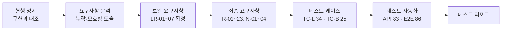

# 틈 · Mini Booking QA

**요구사항 분석 → 테스트 케이스 설계 → 테스트 자동화**의 전 과정을 하나의 서비스로 보여 주는 QA 포트폴리오입니다.

대상은 로컬에서 실행되는 작은 스터디룸 예약 서비스입니다. 기능을 많이 만드는 것이 아니라, **주어진 서비스를 무엇을 근거로, 어떤 기준으로, 어떻게 반복 가능하게 검증하는지**를 보여 주는 것이 목적입니다.

## 이 포트폴리오가 답하려는 질문

| 단계 | 질문 | 산출물 |
|---|---|---|
| 요구사항 분석 | 무엇을 검증해야 하는가? 명세에서 빠졌거나 모호한 것은 무엇인가? | 요구사항 명세, 분석, 보완 요구사항 |
| 테스트 케이스 설계 | 어떤 조건을, 어느 레이어에서, 어떤 우선순위로 검증할 것인가? | 로그인·예약 테스트 케이스 |
| 테스트 자동화 | 어려운 조건(시간 경계, 장애, 동시성)을 어떻게 안정적으로 재현할 것인가? | Playwright API·E2E 테스트, CI |
| 결과 보고 | 무엇이 검증되었고, 그 근거는 무엇인가? | 테스트 리포트 |

서비스 범위는 의도적으로 작게 두었습니다(룸 1개, 데모 계정 3개). 대신 검증이 까다로운 지점인 **로그인 장애 복구, 세션 소멸, 동시 예약, 권한, 데이터 무결성**에 집중했습니다.

## 진행 과정



1. **요구사항 정리:** 기존 README·설계·구현을 대조해 현행 명세를 작성했습니다. → [requirements.md](docs/requirements.md)
2. **요구사항 분석:** 로그인 영역에서 네트워크 실패, 응답 시간 초과, 늦게 도착한 응답, 로그아웃 결과 불명처럼 명세에 정의되지 않은 정책을 찾았습니다. → [login-requirements-analysis.md](docs/login-requirements-analysis.md)
3. **보완과 통합:** 분석 결과를 보완 요구사항으로 확정하고 하나의 최종 명세로 통합했습니다. → [login-requirements-supplement.md](docs/login-requirements-supplement.md), [requirements-final.md](docs/requirements-final.md)
4. **테스트 케이스 설계:** 모든 케이스를 요구사항 ID에 연결하고 입력 조합, 기대 결과, 레이어 선택 이유, 우선순위를 기록했습니다. → [login-test-cases.md](docs/login-test-cases.md), [booking-test-cases.md](docs/booking-test-cases.md)
5. **테스트 자동화:** 케이스 ID를 테스트 제목(`[TC-L-xx]`, `[TC-B-xx]`)으로 연결했습니다. → [tests/](tests/)
6. **테스트 리포트:** 실행 환경, 요구사항별·케이스별 결과, 증적을 기록했습니다. → [login-test-report.md](docs/login-test-report.md), [booking-test-report.md](docs/booking-test-report.md)

## 결과 요약

| 항목 | 수치 |
|---|---|
| 요구사항 | 27개 (기능 R-01~23, 저장·환경 N-01~04) |
| 테스트 케이스 | 59개 (로그인 34, 예약 25), 모두 자동화 테스트와 연결 |
| 자동화 테스트 | 169개 (API 83, E2E 86) |
| 실행 결과 | 전체 통과, 실패·불안정(flaky) 0, 전체 실행 약 26초 |

N-03(실행·테스트 환경)은 별도 케이스 없이 Playwright 설정과 CI로 충족합니다.

## 단계별로 보여 주고 싶은 판단

**요구사항 분석: 구현된 동작을 그대로 명세로 받아들이지 않았습니다.**
현행 명세를 구현과 대조하면서 "지금 이렇게 동작한다"와 "이렇게 동작해야 한다"를 구분했습니다. 로그인 장애 상황의 정책이 비어 있음을 확인하고, 10초 제한, 늦은 응답 무시, 재시도 방식 등을 보완 요구사항으로 확정한 뒤 테스트 기준으로 사용했습니다.

**테스트 케이스 설계: 기준을 먼저 정하고 케이스에 적용했습니다.**
- 우선순위는 "실패 시 보안·데이터 무결성이 깨지거나 핵심 흐름을 이용할 수 없는가"로 판단했습니다. 처음에는 로그인 케이스의 85%가 P1이었으나, 이 기준으로 다시 분류해 P1 16개 / P2 18개로 정리했습니다.
- 서버 규칙은 API로, 화면 상태와 사용자 흐름은 E2E로 검증하고, 케이스마다 레이어 선택 이유를 남겼습니다.
- 색상·테두리 같은 시각적 외형은 디자인 변경에 민감하므로 자동화 범위 밖으로 정의했습니다.

**테스트 자동화: 재현하기 어려운 조건을 운영 코드 수정 없이 통제했습니다.**
- 서버 시간 경계(정확히 현재 시각, 정확히 30일 후, 과거 예약 취소)는 `Date.now()`를 고정한 테스트 전용 서버에서 검증합니다. → [clock-server.js](tests/helpers/clock-server.js)
- 로그인 10초 시간 초과와 늦게 도착한 응답은 브라우저 시계와 테스트용 fetch 대체 계층으로 순서를 제어합니다. 임의의 sleep은 사용하지 않습니다. → [login-resilience.e2e.spec.js](tests/login-resilience.e2e.spec.js)
- 실행마다 임시 DB를 만들고, 테스트마다 전용 데이터를 쓰고 finally에서 정리해 테스트끼리 간섭하지 않게 했습니다.

**검증의 검증: 통과한 테스트도 기대 결과와 다시 대조했습니다.**
모든 테스트가 통과한 상태에서 케이스 문서의 기대 결과와 assertion을 하나씩 대조했습니다. 그 결과 로그인 성공 후 [로그아웃] 버튼 표시, 오류가 표시되는 항목 구분, 실제 401 응답 확인 등 **통과했지만 검증하지 않던 항목**을 찾아 보강했습니다. 통과는 검증과 같지 않습니다.

## AI 활용과 역할 분담

문서 초안, 테스트 코드 구현, 문서와 코드의 대조 작업에는 AI 코딩 도구(Codex, Claude Code)를 활용했습니다. 무엇을 검증할지와 어떤 기준으로 판단할지는 직접 결정했습니다.

- **직접 결정:** 보완 요구사항 확정, 우선순위 기준과 재분류, 자동화 범위(시각적 외형 제외), 리포트 구성, 연습용 테스트 정리와 커버리지 유지 여부
- **AI 활용:** 결정된 기준에 따른 케이스·테스트 초안 작성, 기대 결과와 assertion 대조, 문서 간 불일치 점검

## 문서 안내

| 문서 | 역할 |
|---|---|
| [requirements-final.md](docs/requirements-final.md) | **기준 요구사항** (최종 통합본) |
| [requirements.md](docs/requirements.md), [login-requirements-analysis.md](docs/login-requirements-analysis.md), [login-requirements-supplement.md](docs/login-requirements-supplement.md) | 요구사항 분석·보완 이력 |
| [login-test-cases.md](docs/login-test-cases.md), [booking-test-cases.md](docs/booking-test-cases.md) | 테스트 케이스 |
| [login-test-report.md](docs/login-test-report.md), [booking-test-report.md](docs/booking-test-report.md) | 테스트 실행 리포트 |
| [design.md](docs/design.md) | 서비스 설계와 테스트 레이어 전략 |

## 대상 서비스

- 스터디룸 1개, 한국 시간(KST) 기준 09~18시 운영, 1시간 단위 슬롯 복수 선택, 현재 이후 30일 미만까지 예약
- 계정: 일반 사용자 `alice`, `bob`, 관리자 `admin` (비밀번호 모두 `demo1234`)
- 기능: 로그인·로그아웃, 시간 조회·선택, 단일·복수 예약, 본인 이력 조회·취소, 관리자 시간 잠금
- 구성: React → Express REST API → SQLite (Node 내장)
- 제외: 회원가입, 실제 결제, 여러 룸, 반복 예약, 알림, 운영용 인증

## 실행 방법

Node.js 24 이상이 필요합니다.

```sh
npm ci
npm run dev        # http://127.0.0.1:3000
```

```sh
npx playwright install chromium
npm test           # 전체 테스트
npm run test:api   # API 테스트만
npm run test:e2e   # E2E 테스트만
npm run report     # HTML 리포트 열기
```

테스트는 전용 3100 포트에서 서버를 자동으로 띄우고, 실행마다 임시 DB를 사용하므로 개발용 데이터와 섞이지 않습니다. 실패 시 HTML 리포트와 trace, 스크린샷을 남깁니다. GitHub Actions에서도 같은 테스트를 실행합니다.

## 구조

```text
src/                     React 화면
server/                  REST API(app.js), SQLite 스키마·예약 ID(db.js), 로컬 서버(index.js)
tests/
  login*.spec.js         로그인 테스트 (TC-L)
  booking*.spec.js       예약 테스트 (TC-B)
  helpers/               로그인·예약 헬퍼, 시계 고정 서버, 재시작용 서버
docs/                    요구사항, 테스트 케이스, 리포트
.github/workflows/       CI
```

## 한계와 다음 단계

- Chromium 단일 브라우저에서만 실행합니다. 크로스 브라우저 검증은 범위 밖입니다.
- 공유 DB 경쟁을 피하기 위해 worker 1개로 실행합니다. 병렬화하려면 worker별 서버·DB 격리가 필요합니다.
- 시각적 외형은 자동화 범위 밖입니다. 시각 회귀 테스트는 도입하지 않았습니다.
- 저장 계층 검증은 별도 DB에서 수행합니다. API가 사용하는 실제 DB 파일을 직접 조회하는 통합 검증은 후속 과제입니다.
